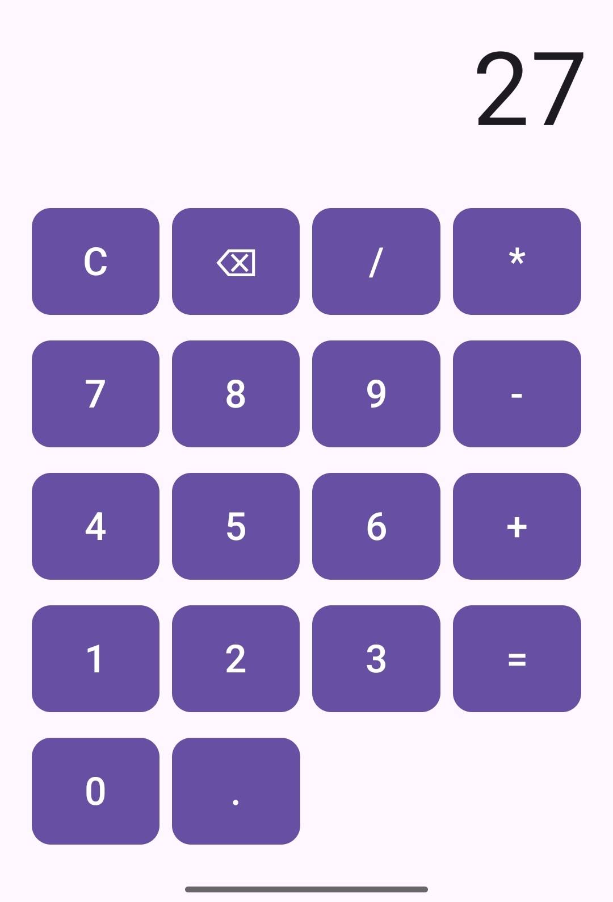
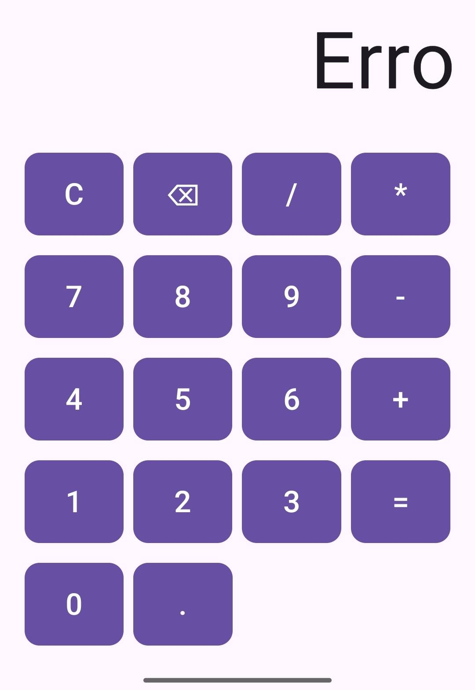

# Calculadora Inteligente - Projeto 02

Aplicativo de calculadora desenvolvido em Kotlin com Jetpack Compose, atendendo aos requisitos do projeto de nível iniciante.

## Funcionalidades Implementadas
- [x] Adição (+)
- [x] Subtração (-)
- [x] Multiplicação (*)
- [x] Divisão (/)
- [x] Exibição de resultados no visor (inteiros e decimais).
- [x] Limpar valores digitados (Botão C).
- [x] Corrigir números digitados incorretamente (Botão ⌫ / Backspace).
- [x] Tratamento de divisões por zero (Exibe "Erro" na tela).
- [x] Bloqueio de múltiplos pontos decimais na mesma operação.

## Conceitos Trabalhados
- **Kotlin**: Funções, operadores matemáticos, manipulação de Strings, condicionais (`if/else`, `when`).
- **Compose**: `Text` para o visor, `Button` para as teclas, `Row` e `Column` para o layout.
- **Estado**: Uso estrito de `mutableStateOf` e `rememberSaveable` para manter o estado da calculadora mesmo ao rotacionar a tela.

## Como Executar
1. Clone ou baixe este repositório.
2. Abra o projeto no Android Studio (Versão mais recente).
3. Aguarde a sincronização do Gradle.
4. Conecte um dispositivo físico ou inicie um Emulador.
5. Clique em **Run 'app'** (Shift + F10).

## Evidências de Projeto
Aqui estão as capturas de tela demonstrando o funcionamento do aplicativo:

**Tela Inicial e Operação Normal: (conta de adição 20 + 7 que deu 27)**

**Tratamento de Divisão por Zero:**

